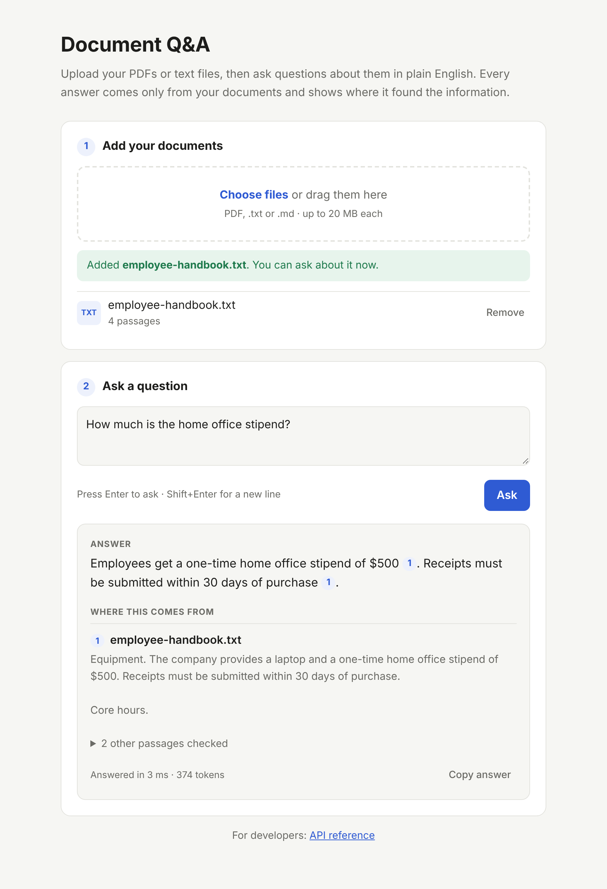
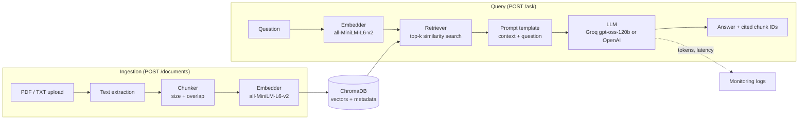

# Document Q&A API

A retrieval-augmented generation (RAG) API that answers questions about your own documents and cites the exact passages it used.

Upload PDF, `.txt` or `.md` files, and the service splits them into chunks, embeds them with a Hugging Face sentence-transformer, and stores them in ChromaDB. When you ask a question, it retrieves the most relevant chunks and asks an LLM (gpt-oss-120b on Groq by default) to answer **only** from that context, returning the chunk IDs it relied on.

**Stack:** FastAPI · sentence-transformers (`all-MiniLM-L6-v2`) · ChromaDB · Groq (gpt-oss-120b) via the OpenAI-compatible API; OpenAI also supported · pytest · Docker

<p align="center">
  
</p>

---

## Features

- A simple web page at `/` with drag-and-drop upload, a list of your documents with Remove, and answers with numbered citations (file name and page) and collapsible sources
- `POST /documents` uploads and indexes PDF, `.txt` or `.md` files (up to 20 MB each), skipping any it can't read
- `GET /documents` lists what has been uploaded, and `DELETE /documents/{doc_id}` removes a document
- `POST /ask` answers a question with citations to the source chunks
- `GET /health` for container and uptime checks (hidden from the API docs)
- Interactive API reference at `/docs`, with endpoints grouped under Documents and Questions
- Re-uploading the same file overwrites its chunks instead of duplicating them
- Local, persistent vector store (ChromaDB, no account required)
- Grounded prompting: the model is told to answer only from retrieved context and to say so when the answer is not there
- Monitoring hooks: every HTTP request is logged with latency and a request ID, and every LLM call is logged with token usage
- Plain-sentence error messages, with clear codes for a missing key (`503`) or a failed LLM call (`502`)
- Free to run: local embeddings plus Groq's free tier, with OpenAI or any other OpenAI-compatible API one setting away
- Offline unit tests with a mocked LLM
- Single-command Docker setup

---

## Architecture



### How a request flows

1. **Ingestion.** Text is extracted page by page from each uploaded file and split into overlapping chunks, preferring paragraph and sentence breaks. Each file gets a document ID made of its name plus a short content hash (`report.pdf-1a2b3c4d`), and each chunk gets an ID such as `report.pdf-1a2b3c4d::7` plus metadata (source file, page, position).
2. **Embedding.** Chunks are embedded with `sentence-transformers/all-MiniLM-L6-v2` (384-dimensional vectors).
3. **Storage.** Vectors, chunk text, and metadata are written to a persistent ChromaDB collection.
4. **Retrieval.** The question is embedded with the same model, and the top-k (default 4) most similar chunks are fetched.
5. **Generation.** The chunks and question are filled into a prompt template that instructs the model to answer only from the context and to cite chunk IDs in square brackets. Temperature is 0 for repeatable answers.
6. **Response.** Citations are parsed out of the answer, and the API returns the answer, the cited chunk IDs, the retrieved source passages, token usage and a latency breakdown.
7. **Monitoring.** Every HTTP request logs one JSON line with its latency, and every `/ask` also logs an `llm_request` line with tokens and retrieval, LLM and total time.

---

## Project structure

```
.
├── app/
│   ├── main.py          # FastAPI app, endpoints and request/response models
│   ├── config.py        # Settings loaded from environment variables or .env
│   ├── chunking.py      # Text extraction (PDF, TXT, MD) and overlapping chunking
│   ├── embeddings.py    # sentence-transformers wrapper
│   ├── vector_store.py  # ChromaDB access and similarity search
│   ├── rag.py           # Pipeline: ingest, retrieve, ask, citation parsing
│   ├── llm.py           # Prompt template and OpenAI-compatible client (Groq, OpenAI)
│   ├── monitoring.py    # Request latency middleware and JSON event logging
│   └── static/
│       └── index.html   # Home page: upload, ask, cited answer
├── tests/               # pytest suite (LLM is mocked)
├── docs/                # README images
├── Dockerfile
├── requirements.txt
├── .env.example
├── LICENSE
└── README.md
```

---

## Getting started

### Prerequisites

- Python 3.11+
- A free Groq API key from [console.groq.com/keys](https://console.groq.com/keys) (or an OpenAI key if you prefer)
- Docker (optional, for the container setup)

### Configuration

Copy the example environment file:

```bash
cp .env.example .env
```

Then get a free API key at [console.groq.com/keys](https://console.groq.com/keys) and put it in `.env`:

```bash
GROQ_API_KEY=gsk_...
```

That's all you need. To use OpenAI instead, set `LLM_PROVIDER=openai` and `OPENAI_API_KEY=sk-...`. For any other OpenAI-compatible API, set `LLM_BASE_URL`, `LLM_API_KEY` and `LLM_MODEL`.

| Variable          | Default                                   | Description                          |
|-------------------|-------------------------------------------|--------------------------------------|
| `LLM_PROVIDER`    | `groq`                                    | `groq` or `openai`                   |
| `GROQ_API_KEY`    | *(required for Groq)*                     | Your Groq API key                    |
| `OPENAI_API_KEY`  | *(required for OpenAI)*                   | Your OpenAI API key                  |
| `LLM_MODEL`       | `openai/gpt-oss-120b` (Groq), `gpt-4o-mini` (OpenAI) | Chat model used for answers |
| `LLM_BASE_URL`    | *(provider default)*                      | Any other OpenAI-compatible endpoint |
| `LLM_API_KEY`     | *(unset)*                                 | Key for `LLM_BASE_URL`; overrides the provider key |
| `EMBEDDING_MODEL` | `sentence-transformers/all-MiniLM-L6-v2`  | Embedding model                      |
| `CHROMA_DIR`      | `./data/chroma`                           | Where ChromaDB persists its data     |
| `CHUNK_SIZE`      | `800`                                     | Characters per chunk                 |
| `CHUNK_OVERLAP`   | `150`                                     | Overlap between neighbouring chunks  |
| `TOP_K`           | `4`                                       | Chunks retrieved per question        |
| `MAX_UPLOAD_MB`   | `20`                                      | Largest file accepted per upload     |

### Run locally

```bash
python -m venv .venv
source .venv/bin/activate        # Windows: .venv\Scripts\activate
pip install -r requirements.txt
uvicorn app.main:app --reload
```

Open `http://localhost:8000` for the web page, where you can upload files and ask questions without writing any code. The API reference is at `http://localhost:8000/docs`. To check the service is up from the command line:

```bash
curl http://localhost:8000/health
# {"status": "ok"}
```

The first local start downloads the embedding model (about 90 MB), so it takes a little longer. The Docker image bakes the model in at build time, so containers start quickly.

### Run with Docker

```bash
docker build -t doc-qa-api .
docker run --rm -p 8000:8000 \
  --env-file .env \
  -v "$(pwd)/data:/app/data" \
  doc-qa-api
```

Then open `http://localhost:8000` as above. The `-v` mount keeps the ChromaDB index between container restarts. Leave it out if you want a fresh index each time.

---

## API usage

### Upload and index documents

```bash
curl -X POST http://localhost:8000/documents \
  -F "files=@docs/employee_handbook.pdf" \
  -F "files=@docs/faq.txt"
```

Example response (`201 Created`):

```json
{
  "indexed": [
    { "doc_id": "employee_handbook.pdf-1a2b3c4d", "filename": "employee_handbook.pdf", "chunks": 42 },
    { "doc_id": "faq.txt-9f8e7d6c", "filename": "faq.txt", "chunks": 6 }
  ],
  "skipped": [],
  "total_chunks": 48
}
```

Files that can't be indexed (unsupported type, empty, over the size limit, damaged, or a scanned PDF with no text) are listed under `skipped` with a reason, and the rest are still indexed:

```json
"skipped": [{ "filename": "scan.pdf", "reason": "No text found in scan.pdf. If it's a scanned PDF, it needs OCR ..." }]
```

The request fails with `400` only if none of the files could be read.

### List documents

```bash
curl http://localhost:8000/documents
```

```json
[
  { "doc_id": "employee_handbook.pdf-1a2b3c4d", "filename": "employee_handbook.pdf", "chunks": 42, "pages": 18 },
  { "doc_id": "faq.txt-9f8e7d6c", "filename": "faq.txt", "chunks": 6, "pages": null }
]
```

### Remove a document

```bash
curl -X DELETE http://localhost:8000/documents/faq.txt-9f8e7d6c
```

Returns `204 No Content`, or `404` if the document doesn't exist.

### Ask a question

```bash
curl -X POST http://localhost:8000/ask \
  -H "Content-Type: application/json" \
  -d '{"question": "How many vacation days do new employees get?", "top_k": 4}'
```

Example response:

```json
{
  "answer": "New employees receive 15 vacation days per year, which increases to 20 after three years of service [employee_handbook.pdf-1a2b3c4d::12].",
  "citations": ["employee_handbook.pdf-1a2b3c4d::12"],
  "sources": [
    {
      "chunk_id": "employee_handbook.pdf-1a2b3c4d::12",
      "source": "employee_handbook.pdf",
      "page": 7,
      "score": 0.8213,
      "cited": true,
      "text": "Full-time employees accrue 15 days of paid vacation per year during their first three years..."
    }
  ],
  "model": "openai/gpt-oss-120b",
  "usage": { "prompt_tokens": 912, "completion_tokens": 48, "total_tokens": 960 },
  "latency_ms": { "retrieval_ms": 35.2, "llm_ms": 1190.4, "total_ms": 1240.1 }
}
```

`top_k` is optional (1 to 10) and defaults to `TOP_K`. `sources` lists every retrieved chunk, with `cited: true` on the ones the answer actually used, and `citations` lists those chunk IDs. `page` is `null` for text files.

If the answer is not in the indexed documents, the model replies "I couldn't find the answer to that in your documents." instead of guessing. If nothing has been uploaded yet, `/ask` says so without calling the LLM.

Errors come back as plain sentences in FastAPI's usual `{"detail": "..."}` body:

| Status | When |
|--------|------|
| `422`  | The question is empty, too long, or `top_k` is out of range |
| `502`  | The LLM call failed (bad key, no credit left, rate limit, unknown model, or no connection) |
| `503`  | No API key is set for the chosen provider |

### Monitoring output

Every HTTP request writes a `request` log line, and its response carries `X-Request-ID` and `X-Latency-Ms` headers:

```json
{"event": "request", "request_id": "3f9c2a7b1d4e", "method": "POST", "path": "/ask", "status": 200, "latency_ms": 1242.6}
```

Each `/ask` also writes an `llm_request` line with the same request ID:

```json
{"event": "llm_request", "request_id": "3f9c2a7b1d4e", "model": "openai/gpt-oss-120b", "chunks_retrieved": 4, "citations": 1, "prompt_tokens": 912, "completion_tokens": 48, "total_tokens": 960, "retrieval_ms": 35.2, "llm_ms": 1190.4, "total_ms": 1240.1}
```

These lines can be shipped to any log aggregator to track cost and latency over time.

---

## Troubleshooting

Error messages name the provider you're using (Groq or OpenAI).

| Problem | What to do |
|---------|------------|
| `/ask` returns `503` asking for an API key | Add `GROQ_API_KEY` (or `OPENAI_API_KEY` with `LLM_PROVIDER=openai`) to `.env`, or pass `--env-file .env` to `docker run`, and restart. |
| "Groq rejected the API key" | Create a new key at [console.groq.com/keys](https://console.groq.com/keys) and check `.env` has no quotes or spaces around it. |
| "...rate limit was reached" (`429`) | Too many requests in a short time. Wait a minute and try again. On Groq's free tier, `LLM_MODEL=openai/gpt-oss-20b` is smaller and faster. |
| "Your OpenAI account has no credit left" (`429 insufficient_quota`) | New OpenAI accounts need prepaid credit under [Billing](https://platform.openai.com/settings/organization/billing), or switch to Groq's free tier with `LLM_PROVIDER=groq`. |
| "...doesn't recognise the model" | Set `LLM_MODEL` to a model your provider offers, or remove it to use the default. |
| "Couldn't reach Groq" (or OpenAI) | Check your internet connection, or a proxy or firewall blocking `api.groq.com` / `api.openai.com`. |
| A PDF is skipped with "No text found" | It is probably a scanned image. Run it through OCR first, or upload a text version. |
| First local start is slow | The embedding model (about 90 MB) downloads once. Docker images already include it. |

---

## Testing

```bash
pytest -v

# optional coverage report
pip install pytest-cov
pytest --cov=app --cov-report=term-missing
```

They cover chunking (sizes, overlap, sentence-aware cuts, empty and very short text), text extraction, retrieval ranking and top-k, idempotent re-uploads, listing and removing documents, skipped files on upload, prompt building, citation parsing (including dropping citations to chunks that were not retrieved), the LLM client, and every endpoint including the home page, validation, and error codes (`400`, `404`, `422`, `502`, `503`), plus the mapping of each LLM API failure (bad key, rate limit, unknown model, connection, server error) to a readable message. The suite has 61 tests and runs fully offline with no API key: it uses a fake embedder, an in-memory ChromaDB collection and a mocked LLM client.

---

## Design decisions

- **Local embeddings, hosted LLM.** Embedding with sentence-transformers keeps ingestion free and private. Only the retrieved chunks and the question are sent to the LLM provider. Groq and OpenAI share one client through the OpenAI-compatible API, so switching provider is a config change, not a code change.
- **Overlapping chunks.** Overlap stops answers from being cut in half at chunk boundaries.
- **Stable chunk IDs.** IDs combine the file name, a short hash of its contents, and the chunk index. Citations stay readable and traceable, and re-uploading the same file overwrites its chunks instead of duplicating them.
- **Grounded prompt.** The model is instructed to use only the provided context and to cite every claim, which makes hallucinations easier to spot.

---

## Future improvements

- **Reranking.** Retrieve a larger candidate set (for example top 20) and rerank with a cross-encoder such as `cross-encoder/ms-marco-MiniLM-L-6-v2` to improve precision before generation.
- **Hybrid search.** Combine vector similarity with BM25 keyword search so exact terms like product codes and names are not missed.
- **Evaluation metrics.** Build a small labelled question set and measure retrieval quality (recall@k, MRR) and answer quality (faithfulness, answer relevance, citation accuracy), for example with RAGAS or an LLM-as-judge.
- **Smarter chunking.** Split on headings and sentences rather than fixed character counts, and keep table structure from PDFs.
- **Streaming responses.** Stream the answer token by token for a faster perceived response.
- **Multi-user support.** Separate collections per user or workspace, so each person only searches their own documents.
- **Production hardening.** API key auth, rate limiting, async background ingestion for large files, and metrics exported to Prometheus or OpenTelemetry.

---

## License

MIT. See [LICENSE](LICENSE).
